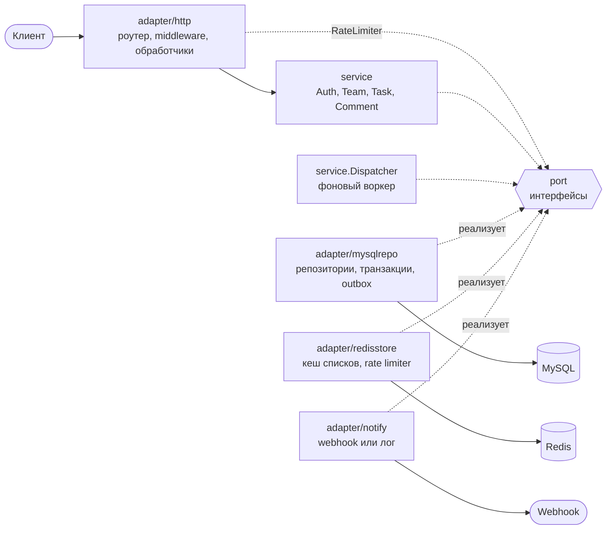
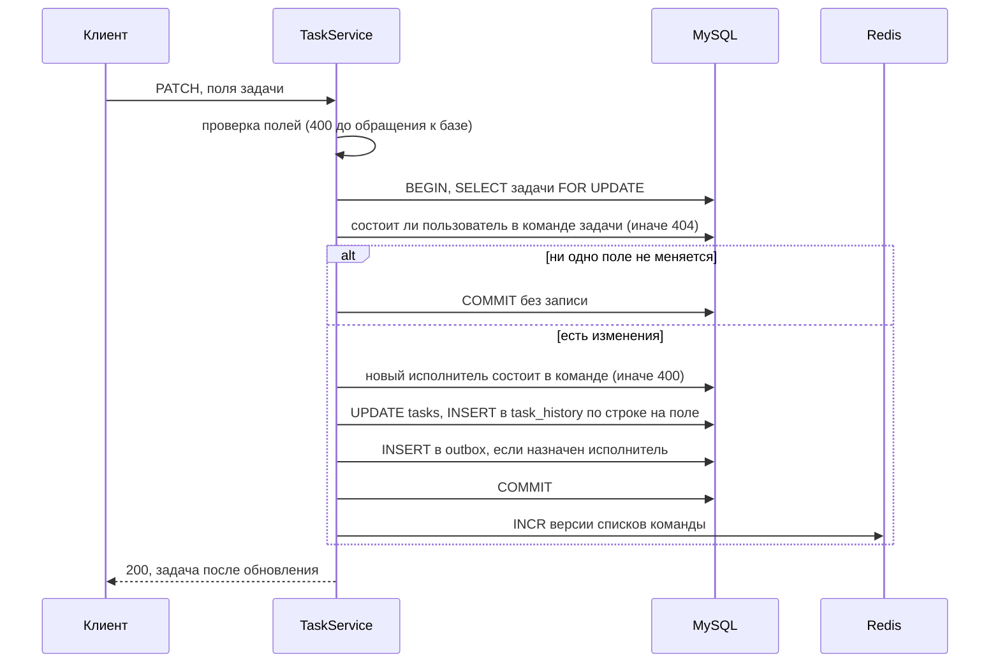

# team-task-nexus

[](https://github.com/andrewhigh08/team-task-nexus/actions/workflows/ci.yml)
[](go.mod)
[](LICENSE)

**Summary.** team-task-nexus is a REST API for team task management written in Go: teams with owner,
admin and member roles, tasks with partial updates and a per-field change history, comments, and team
analytics built on correlated subqueries and a `RANK()` window function. Every team and everything in it
is visible to its members only; outsiders get 404, so ids cannot be probed. Task updates run under a row
lock, task assignments and comments emit events through a transactional outbox (`SKIP LOCKED` claims,
leases, exponential backoff, at-least-once delivery to a webhook), team task lists are cached in Redis
and invalidated through per-team version counters, and requests are rate limited by a sliding-window Lua
script in Redis. Stack: Go 1.26, chi, sqlx, MySQL 8.4, Redis 8, Prometheus. `make up` starts the API with
MySQL, Redis and Prometheus through Docker Compose; a curl walkthrough and the configuration reference are
below. The design decisions are recorded in [docs/adr](docs/adr). The rest of this document is in Russian.

REST API для командной работы с задачами на Go. Пользователи объединяются в команды с ролями, ведут
задачи с историей изменений и комментариями, смотрят аналитику по командам. Внешние системы узнают
о назначениях и комментариях через события, которые сервис доставляет на webhook.

## Что умеет

**Команды и роли**
- Создатель команды становится её владельцем (`owner`). Владелец и администраторы (`admin`) добавляют
  зарегистрированных пользователей по email; назначать администраторов может только владелец.
- Владелец удаляет любого участника, кроме себя; администратор удаляет только обычных участников
  (`member`); любой участник, кроме владельца, может выйти из команды сам.
- Задачи ушедшего участника остаются назначенными на него; отчёт `orphaned-assignees` показывает их
  владельцу и администраторам, чтобы переназначить.
- Команда и всё, что в ней есть, видны только её участникам. Остальные получают 404, как на
  несуществующий id.

**Задачи**
- Статусы `todo`, `in_progress`, `review`, `done` (из любого статуса можно перейти в любой), приоритет
  1, 2 или 3, исполнитель из участников команды, срок в виде даты.
- Частичное обновление `PATCH`: отсутствующее поле не меняется, `null` очищает `assignee_id` и `due_date`.
  Каждое изменённое поле записывается в историю (старое и новое значение, автор, время); обновление, которое
  ничего не меняет, ничего и не пишет. `completed_at` выставляется при переходе в `done` и сбрасывается
  при выходе из него.
- Обновление идёт под блокировкой строки задачи, поэтому одновременные `PATCH` применяются по очереди
  и ни одно изменение не теряется.
- Список задач с фильтрами `team_id`, `status`, `assignee_id` и постраничным выводом; без `team_id`
  выводятся задачи всех команд пользователя.
- Комментарии к задачам. Историю и комментарии задачи, как и список задач, сервис отдаёт постранично.

**Аналитика**
- Статистика по всем командам пользователя: число участников, открытых задач и задач, выполненных
  за последние 7 дней.
- Лучшие участники команды по числу задач, выполненных за 30 дней; равные результаты делят место.
- Задачи, назначенные бывшим участникам команды.

**События**
- Назначение задачи и новый комментарий записывают событие в таблицу `outbox` в той же транзакции, что
  и само изменение. Фоновый диспетчер доставляет события на webhook (или в лог, если webhook не задан)
  с повторами и экспоненциальной задержкой; доставка не реже одного раза (at-least-once).

**Защита и нагрузка**
- JWT HS256 со строгой проверкой алгоритма, издателя и срока; пароли в bcrypt. Неверный пароль и
  неизвестный email получают одинаковый ответ, в том числе по времени.
- Ограничение частоты запросов в Redis одним Lua-скриптом: на пользователя для API и на адрес клиента
  для регистрации и входа. Лимит общий для всех реплик.
- Кеш списков задач команды в Redis со сбросом через версию команды.
- Строгий разбор запросов: тело только `application/json` и не больше 1 MiB, неизвестные поля
  и некорректные параметры запроса отклоняются с 400, а не игнорируются.

**Эксплуатация**
- Конфигурация из переменных окружения с проверкой при старте; миграции встроены в бинарник
  и применяются при запуске.
- Метрики Prometheus, структурированные логи `log/slog` с `request_id` и `user_id`, liveness- и
  readiness-пробы, graceful shutdown.
- Контракт OpenAPI 3.1 в [api/openapi.yaml](api/openapi.yaml), сервис отдаёт его по `/openapi.yaml`;
  тест сверяет контракт с маршрутами роутера в обе стороны.
- Docker-образ без root, `docker compose` с MySQL, Redis и Prometheus.

## Быстрый старт

Нужны Docker и Docker Compose v2; для примеров ниже ещё `curl` и `jq`.

```bash
git clone https://github.com/andrewhigh08/team-task-nexus.git
cd team-task-nexus
make up            # API, MySQL 8.4, Redis 8, Prometheus
```

| Что | Где |
|-----|-----|
| API | http://localhost:8080 |
| Контракт OpenAPI | http://localhost:8080/openapi.yaml |
| Метрики | http://localhost:8080/metrics |
| Prometheus | http://localhost:9090 |

`make logs` показывает логи API, `make down` останавливает стек и удаляет тома с данными. Запуск
приложения без контейнера: поднять зависимости `docker compose up -d mysql redis`, скопировать
`.env.example` в `.env` и выполнить `make run`.

### Пример: от регистрации до истории задачи

Ответы ниже получены на compose-стеке. Регистрация и вход в нём ограничены 10 запросами в минуту
с одного адреса.

Регистрация. Ответ на вход (`POST /api/v1/login`) такой же, только со статусом 200:

```bash
curl -s http://localhost:8080/api/v1/register \
  -H 'Content-Type: application/json' \
  -d '{"email":"alice@example.com","password":"correct-horse-battery","full_name":"Alice Smith"}'
```

```json
{
  "success": true,
  "data": {
    "access_token": "eyJhbGciOiJIUzI1NiIsInR5cCI6IkpXVCJ9...",
    "token_type": "Bearer",
    "expires_in": 86400,
    "user": {
      "id": 1,
      "email": "alice@example.com",
      "full_name": "Alice Smith",
      "created_at": "2026-10-14T16:57:08Z"
    }
  }
}
```

Второй пользователь, которого Алиса добавит в команду, и вход Алисы с сохранением токена:

```bash
curl -s http://localhost:8080/api/v1/register \
  -H 'Content-Type: application/json' \
  -d '{"email":"bob@example.com","password":"another-long-secret","full_name":"Bob Jones"}'

TOKEN=$(curl -s http://localhost:8080/api/v1/login \
  -H 'Content-Type: application/json' \
  -d '{"email":"alice@example.com","password":"correct-horse-battery"}' | jq -r .data.access_token)
```

Команда; создатель становится её владельцем:

```bash
curl -s http://localhost:8080/api/v1/teams \
  -H "Authorization: Bearer $TOKEN" -H 'Content-Type: application/json' \
  -d '{"name":"Platform","description":"Backend services"}'
```

```json
{
  "success": true,
  "data": {
    "id": 1,
    "name": "Platform",
    "description": "Backend services",
    "owner_id": 1,
    "created_at": "2026-10-14T16:57:19Z",
    "updated_at": "2026-10-14T16:57:19Z"
  }
}
```

Новый участник; роль `admin` или `member`, по умолчанию `member`:

```bash
curl -s http://localhost:8080/api/v1/teams/1/members \
  -H "Authorization: Bearer $TOKEN" -H 'Content-Type: application/json' \
  -d '{"email":"bob@example.com","role":"member"}'
```

```json
{
  "success": true,
  "data": {
    "user_id": 2,
    "email": "bob@example.com",
    "full_name": "Bob Jones",
    "role": "member"
  }
}
```

Задача; без `priority` она получила бы приоритет 2, статус новой задачи всегда `todo`:

```bash
curl -s http://localhost:8080/api/v1/tasks \
  -H "Authorization: Bearer $TOKEN" -H 'Content-Type: application/json' \
  -d '{"team_id":1,"title":"Add rate limiting","description":"Per-user limit on the API","priority":3,"due_date":"2026-11-01"}'
```

```json
{
  "success": true,
  "data": {
    "id": 1,
    "team_id": 1,
    "title": "Add rate limiting",
    "description": "Per-user limit on the API",
    "status": "todo",
    "priority": 3,
    "creator_id": 1,
    "assignee_id": null,
    "due_date": "2026-11-01",
    "completed_at": null,
    "created_at": "2026-10-14T16:57:25Z",
    "updated_at": "2026-10-14T16:57:25Z"
  }
}
```

Частичное обновление: взять задачу в работу, назначить Боба и снять срок. Остальные поля не меняются:

```bash
curl -s -X PATCH http://localhost:8080/api/v1/tasks/1 \
  -H "Authorization: Bearer $TOKEN" -H 'Content-Type: application/json' \
  -d '{"status":"in_progress","assignee_id":2,"due_date":null}'
```

```json
{
  "success": true,
  "data": {
    "id": 1,
    "team_id": 1,
    "title": "Add rate limiting",
    "description": "Per-user limit on the API",
    "status": "in_progress",
    "priority": 3,
    "creator_id": 1,
    "assignee_id": 2,
    "due_date": null,
    "completed_at": null,
    "created_at": "2026-10-14T16:57:25Z",
    "updated_at": "2026-10-14T16:57:30Z"
  }
}
```

Назначение записало в outbox событие `task.assigned`. В compose-стеке webhook не задан, поэтому диспетчер
пишет событие в лог (`make logs`, сообщение `event delivered`).

История задачи, новые записи первыми, по 20 записей на страницу, пока `page` и `page_size` не заданы
иначе. Значения хранятся строками, пустая строка означает «нет значения»:

```bash
curl -s http://localhost:8080/api/v1/tasks/1/history -H "Authorization: Bearer $TOKEN"
```

```json
{
  "success": true,
  "data": [
    {
      "id": 3,
      "task_id": 1,
      "user_id": 1,
      "field": "due_date",
      "old_value": "2026-11-01",
      "new_value": "",
      "changed_at": "2026-10-14T16:57:30Z"
    },
    {
      "id": 2,
      "task_id": 1,
      "user_id": 1,
      "field": "assignee_id",
      "old_value": "",
      "new_value": "2",
      "changed_at": "2026-10-14T16:57:30Z"
    },
    {
      "id": 1,
      "task_id": 1,
      "user_id": 1,
      "field": "status",
      "old_value": "todo",
      "new_value": "in_progress",
      "changed_at": "2026-10-14T16:57:30Z"
    }
  ],
  "meta": {
    "page": 1,
    "page_size": 20,
    "total": 3,
    "total_pages": 1
  }
}
```

Список задач команды с фильтром по статусу; `meta`, как и в истории, описывает страницу:

```bash
curl -s 'http://localhost:8080/api/v1/tasks?team_id=1&status=in_progress' -H "Authorization: Bearer $TOKEN"
```

```json
{
  "success": true,
  "data": [
    {
      "id": 1,
      "team_id": 1,
      "title": "Add rate limiting",
      "description": "Per-user limit on the API",
      "status": "in_progress",
      "priority": 3,
      "creator_id": 1,
      "assignee_id": 2,
      "due_date": null,
      "completed_at": null,
      "created_at": "2026-10-14T16:57:25Z",
      "updated_at": "2026-10-14T16:57:30Z"
    }
  ],
  "meta": {
    "page": 1,
    "page_size": 20,
    "total": 1,
    "total_pages": 1
  }
}
```

Пользователь, который не состоит в команде, получает на ту же задачу 404, а не 403:

```json
{
  "success": false,
  "error": {
    "code": "NOT_FOUND",
    "message": "task not found",
    "details": { "id": 1, "resource": "task" }
  }
}
```

## API

Ответы `/api/v1/*` приходят в едином конверте: `{"success": true, "data": ...}` при успехе (для постраничных
списков ещё `meta`) и `{"success": false, "error": {"code", "message", "details"}}` при ошибке. Без конверта
приходят только 204 без тела и 405, когда маршрут существует, но метод не поддерживается: пустое тело
и заголовок `Allow`. Пустые списки приходят как `[]`, не `null`. Путь, которому не соответствует ни один
маршрут, получает 404 `NOT_FOUND` в конверте. Исключения: `/health/*` отвечают собственной структурой,
`/metrics` отдаёт текстовый формат Prometheus, `/openapi.yaml` отдаёт YAML. Время передаётся в RFC 3339
в UTC, сроки задач датой `YYYY-MM-DD`. Каждый ответ несёт `X-Request-ID`: идентификатор клиента, если он
состоит из 1-64 символов `[A-Za-z0-9._-]`, иначе сгенерированный; по нему находятся все записи лога
запроса.

| Метод | Путь | Доступ | Описание |
|-------|------|--------|----------|
| `GET` | `/health/live` | публичный | Liveness: `{"status":"ok"}`, зависимости не проверяются |
| `GET` | `/health/ready` | публичный | Readiness: MySQL и Redis отвечают (200) или нет (503) |
| `GET` | `/metrics` | публичный | Метрики Prometheus |
| `GET` | `/openapi.yaml` | публичный | Контракт OpenAPI 3.1 |
| `POST` | `/api/v1/register` | публичный, лимит на адрес | Регистрация, 201 и токен; занятый email 409 |
| `POST` | `/api/v1/login` | публичный, лимит на адрес | Вход, 200 и токен; неверные данные 401 |
| `POST` | `/api/v1/teams` | JWT | Создать команду; создатель становится владельцем |
| `GET` | `/api/v1/teams` | JWT | Команды пользователя с его ролью (`role`), новые первыми |
| `GET` | `/api/v1/teams/stats` | JWT | Статистика по каждой команде пользователя |
| `GET` | `/api/v1/teams/{id}` | участник | Команда |
| `GET` | `/api/v1/teams/{id}/members` | участник | Участники: владелец, администраторы, остальные; внутри групп по имени |
| `POST` | `/api/v1/teams/{id}/members` | owner, admin | Добавить пользователя по email; неизвестный email 404, уже участник 409 |
| `DELETE` | `/api/v1/teams/{id}/members/{user_id}` | см. правила доступа | Удалить участника или выйти из команды, 204 |
| `GET` | `/api/v1/teams/{id}/top-contributors` | участник | Лучшие участники по задачам, выполненным за 30 дней |
| `GET` | `/api/v1/teams/{id}/orphaned-assignees` | owner, admin | Задачи, назначенные бывшим участникам |
| `POST` | `/api/v1/tasks` | участник команды `team_id` | Создать задачу, 201 |
| `GET` | `/api/v1/tasks` | JWT | Страница задач команд пользователя, новые первыми |
| `GET` | `/api/v1/tasks/{id}` | участник | Задача |
| `PATCH` | `/api/v1/tasks/{id}` | участник | Частичное обновление с записью истории |
| `GET` | `/api/v1/tasks/{id}/history` | участник | Страница истории изменений, новые первыми |
| `POST` | `/api/v1/tasks/{id}/comments` | участник | Комментарий, 201 |
| `GET` | `/api/v1/tasks/{id}/comments` | участник | Страница комментариев, старые первыми |

«JWT» означает любого аутентифицированного пользователя, «участник» означает участника команды, к которой
относится ресурс. Схемы запросов и ответов, примеры и коды ошибок каждого маршрута описаны в
[api/openapi.yaml](api/openapi.yaml); запущенный сервис отдаёт его по `GET /openapi.yaml`.

Общие правила:

- Токен передаётся в одном заголовке `Authorization: Bearer <token>`, схема без учёта регистра.
- Тело запроса только `application/json` (иначе 415), не больше 1 MiB (иначе 413), ровно одно
  JSON-значение без неизвестных полей (иначе 400 `BAD_REQUEST`).
- Идентификаторы в пути и в параметрах запроса должны быть положительными целыми, иначе 400.
- Список задач: `team_id`, `status`, `assignee_id`, `page` от 1 до 10000 (по умолчанию 1), `page_size`
  от 1 до 100 (по умолчанию 20); неизвестный статус и значения вне диапазона дают 400. Сортировка
  `created_at DESC, id DESC`.
- История и комментарии задачи: `page` и `page_size` с теми же пределами, значениями по умолчанию
  и ошибками, что у списка задач, и `meta` в ответе. Сортировка истории `changed_at DESC, id DESC`,
  комментариев `created_at ASC, id ASC`.
- Ограничения полей. Пароль от 8 до 72 байт (bcrypt учитывает только первые 72) и не обрезается.
  Текстовые поля обрезаются от пробелов по краям, длина считается в символах: email до 254 (хранится
  в нижнем регистре, принимается только сам адрес, без имени), имя пользователя от 1 до 255, название
  команды от 1 до 255, описание команды до 5000, заголовок задачи от 1 до 255, описание задачи до 10000,
  комментарий от 1 до 5000.
- В `PATCH` поля `title`, `description`, `status` и `priority` нельзя передать как `null`. Значение,
  равное текущему, изменением не считается.

Ошибки валидации называют все неверные поля сразу:

```json
{
  "success": false,
  "error": {
    "code": "VALIDATION_ERROR",
    "message": "invalid input",
    "details": {
      "fields": {
        "priority": "must be 1 (low), 2 (medium) or 3 (high)",
        "status": "must be one of todo, in_progress, review, done"
      }
    }
  }
}
```

| Код | HTTP | Когда |
|-----|------|-------|
| `BAD_REQUEST` | 400 | Тело не разбирается как JSON нужной формы или содержит неизвестные поля |
| `VALIDATION_ERROR` | 400 | Неверные значения полей или параметров; `details.fields` называет каждое |
| `UNAUTHORIZED` | 401 | Нет токена, он неверен или истёк; неверные email или пароль при входе |
| `FORBIDDEN` | 403 | Участнику команды не хватает роли |
| `NOT_FOUND` | 404 | Ресурса нет или пользователь не состоит в его команде |
| `CONFLICT` | 409 | Email уже зарегистрирован, пользователь уже в команде |
| `PAYLOAD_TOO_LARGE` | 413 | Тело больше 1 MiB |
| `UNSUPPORTED_MEDIA_TYPE` | 415 | Тело не `application/json` |
| `TOO_MANY_REQUESTS` | 429 | Превышен лимит; `Retry-After` и `details.retry_after_seconds` |
| `INTERNAL_ERROR` | 500 | Внутренняя ошибка; клиент видит только общее сообщение, причина пишется в лог |

## Права доступа

Подробное обоснование: [ADR 0002](docs/adr/0002-team-scoped-authorization.md).

- **Членство решает видимость.** Команда, в которой пользователь не состоит, и всё, что в ней (задачи,
  история, комментарии, участники, аналитика), отвечает 404 `team not found` или `task not found`, так же
  как несуществующий id. То же для `team_id` при создании задачи и в фильтре списка.
- **Роль решает действия.** Участник без нужной роли получает 403 `FORBIDDEN`: он и так знает, что команда
  существует.
- **Списки ограничены в SQL.** Запрос списка задач всегда содержит условие «команды пользователя», какие бы
  фильтры ни пришли; без `team_id` выводятся задачи всех его команд.
- Членство проверяется по базе на каждом запросе, поэтому удаление из команды действует сразу, а не после
  истечения токена.
- Исполнителем задачи может быть только участник её команды, иначе 400 с полем `assignee_id`.

| Действие | owner | admin | member |
|----------|:-----:|:-----:|:------:|
| Видеть команду, участников, задачи, историю, комментарии, лучших участников | да | да | да |
| Создавать и менять задачи, комментировать | да | да | да |
| Добавить участника с ролью `member` | да | да | 403 |
| Добавить участника с ролью `admin` | да | 403 | 403 |
| Удалить другого участника с ролью `member` | да | да | 403 |
| Удалить другого участника с ролью `admin` | да | 403 | 403 |
| Выйти из команды (удалить себя) | 403 | да | да |
| Видеть задачи бывших участников | да | да | 403 |

Не участник команды на всё это получает 404. Владелец не может выйти из команды: передачи владения нет.
Любой участник может менять любую задачу своей команды, в том числе переназначать её; прав на уровне
отдельной задачи нет.

## Конфигурация

Только переменные окружения. Если в рабочей директории есть файл `.env`, он читается, но не перекрывает
уже заданные переменные; шаблон с пояснениями в [.env.example](.env.example). При старте проверяются все
значения сразу: каждое сообщение называет переменную, и при любой ошибке процесс завершается с кодом 1.

| Переменная | По умолчанию | Описание |
|------------|--------------|----------|
| `SERVER_PORT` | `8080` | Порт HTTP-сервера, от 1 до 65535 |
| `SERVER_READ_HEADER_TIMEOUT` | `5s` | Время на чтение заголовков запроса |
| `SERVER_READ_TIMEOUT`, `SERVER_WRITE_TIMEOUT` | `15s`, `15s` | Время на чтение запроса и на запись ответа |
| `SERVER_IDLE_TIMEOUT` | `60s` | Сколько держать простаивающее keep-alive соединение |
| `SERVER_SHUTDOWN_TIMEOUT` | `10s` | Время на завершение запросов при остановке |
| `TRUST_PROXY_HEADERS` | `false` | Брать адрес клиента из `X-Forwarded-For` и `X-Real-IP`; только за прокси, который их перезаписывает |
| `LOG_LEVEL` | `info` | `debug`, `info`, `warn` или `error` |
| `LOG_FORMAT` | `json` | `json` или `text` |
| `DB_HOST`, `DB_PORT` | `localhost`, `3306` | Адрес MySQL; порт от 1 до 65535 |
| `DB_USER`, `DB_PASSWORD`, `DB_NAME` | `app`, пусто, `team_task_nexus` | Учётные данные и база |
| `DB_MAX_OPEN_CONNS` | `25` | Максимум соединений в пуле, не меньше 1 |
| `DB_MAX_IDLE_CONNS` | `10` | Простаивающих соединений, от 0 до `DB_MAX_OPEN_CONNS` |
| `DB_CONN_MAX_LIFETIME` | `5m` | Время жизни соединения |
| `DB_CONNECT_TIMEOUT` | `30s` | Сколько при старте ждать MySQL и Redis, повторяя попытки с растущей паузой |
| `REDIS_ADDR` | `localhost:6379` | Адрес Redis |
| `REDIS_PASSWORD`, `REDIS_DB` | пусто, `0` | Пароль и номер базы Redis |
| `JWT_SECRET` | нет, обязательна | Ключ подписи HS256, не короче 32 байт |
| `JWT_ISSUER` | `team-task-nexus` | Значение `iss` при выпуске и при проверке |
| `JWT_TTL` | `24h` | Время жизни токена, от `1m` до `720h` |
| `BCRYPT_COST` | `10` | Стоимость bcrypt, от 4 до 31 |
| `RATE_LIMIT_API_PER_MINUTE` | `100` | Запросов в минуту на пользователя к защищённым маршрутам |
| `RATE_LIMIT_AUTH_PER_MINUTE` | `10` | Запросов в минуту с одного адреса к регистрации и входу |
| `CACHE_TASK_LIST_TTL` | `5m` | Время жизни страницы списка задач в кеше; оно же предел устаревания при сбое сброса |
| `OUTBOX_POLL_INTERVAL` | `1s` | Как часто диспетчер забирает готовые события |
| `OUTBOX_BATCH_SIZE` | `50` | Событий за один раз, от 1 до 500 |
| `OUTBOX_MAX_ATTEMPTS` | `10` | Попыток доставки, после которых событие помечается неудавшимся |
| `OUTBOX_LEASE` | `30s` | Аренда забранных событий; должна быть больше `NOTIFY_WEBHOOK_TIMEOUT` |
| `NOTIFY_WEBHOOK_URL` | пусто | Куда отправлять события; пусто означает запись в лог. Абсолютный http(s) URL, в логи не попадает |
| `NOTIFY_WEBHOOK_TIMEOUT` | `5s` | Предел одной доставки |

Длительности и числа, для которых диапазон не указан, должны быть больше нуля, `REDIS_DB` не меньше нуля;
`DB_HOST`, `DB_USER`, `DB_NAME`, `REDIS_ADDR` и `JWT_ISSUER` не могут быть пустыми. `docker-compose.yml`
задаёт `JWT_SECRET` и пароли только для локальной работы; в любом реальном окружении их нужно заменить.

## Архитектура

Проект построен по принципу «порты и адаптеры»: бизнес-логика в `internal/service` зависит только от
доменных типов (`internal/domain`), интерфейсов (`internal/port`) и общих пакетов (`internal/pkg`).
Реализации интерфейсов живут в `internal/adapter`, сборка зависимостей в `internal/app`. Направление
зависимостей проверяет тест `internal/service/deps_test.go`: сервисный слой не может импортировать
адаптеры. Подробнее: [ADR 0001](docs/adr/0001-ports-and-adapters-with-sqlx.md) и, о выборе chi и sqlx,
[ADR 0006](docs/adr/0006-chi-and-sqlx.md).



Транзакции пересекают границу слоёв через `port.TxManager`: сервис вызывает `WithinTx(ctx, fn)`, реализация
кладёт `*sqlx.Tx` в контекст, а репозитории выполняют запросы в транзакции из контекста или, если её нет,
на пуле соединений. Вложенный вызов присоединяется к внешней транзакции; ошибка или паника в `fn` откатывает
её. `GetByIDForUpdate` и запись в outbox вне транзакции отказываются работать, а не выполняются молча.

Путь запроса через middleware (снаружи внутрь):

```text
RequestID -> Recoverer -> AccessLog -> Metrics -> SecurityHeaders -> BodyLimit(1 MiB) -> маршрут
    /api/v1/register, /api/v1/login:  RateLimitByIP -> обработчик
    остальные /api/v1/*:              Authenticate -> RateLimitByUser -> обработчик
```

Обработчик разбирает запрос в DTO, переводит его во входные данные порта, вызывает сервис и переводит
результат обратно в DTO ответа; домен JSON не видит. Ошибки идут через слои как `*apperror.AppError`
со строковым кодом, а `response.Error` превращает их в конверт ответа.

Структура репозитория:

```text
cmd/api/              точка входа: конфигурация, логгер, сигналы, app.New и Run
api/                  контракт OpenAPI 3.1, встроен в бинарник
internal/app/         сборка зависимостей, MySQL, Redis, миграции, HTTP-сервер, воркеры, остановка
internal/config/      конфигурация из переменных окружения и её проверка
internal/domain/      сущности, перечисления, доменные события; без JSON- и SQL-тегов
internal/port/        интерфейсы между слоями
internal/service/     бизнес-логика и диспетчер outbox
internal/adapter/     http (роутер, обработчики и DTO, middleware, конверт ответа), mysqlrepo (MySQL),
                      redisstore (Redis), notify (webhook и лог)
internal/pkg/         apperror, logger, metrics, opt (поля PATCH)
configs/              конфигурация Prometheus для compose
migrations/           SQL-миграции (golang-migrate, встроены через embed)
test/integration/     сквозные тесты на MySQL и Redis (testcontainers)
test/mocks/           gomock-моки портов (генерируются, `make generate`)
docs/adr/             архитектурные решения
```

## Как это работает

### Обновление задачи



`PATCH` разбирает тело в `opt.Field[T]`, который различает отсутствующее поле, `null` и значение. Сервис
блокирует строку задачи (`SELECT ... FOR UPDATE`) в транзакции, сравнивает новые значения с текущими
и пишет, только если что-то изменилось: задачу целиком одним `UPDATE`, по строке истории на каждое
изменённое поле одним многострочным `INSERT`, событие `task.assigned`, если задачу назначили
на пользователя. Ошибка записи истории откатывает всё обновление. Параллельные обновления одной задачи
ждут блокировку и применяются по очереди, поэтому каждая запись истории содержит именно то значение,
которое она заменила. `completed_at` ставится по часам сервиса при переходе в `done` и сбрасывается при
выходе из `done`. Кеш списков сбрасывается только после коммита и только если что-то изменилось.

### Кеш списков задач

Кешируются только списки одной команды (с `team_id`), уже после проверки членства: все участники видят
одни и те же задачи команды, поэтому пользователь в ключ не входит. Списки по всем командам пользователя
у каждого свои и всегда читаются из MySQL.

```text
tasks:team:<id>:ver                                               счётчик версии, без TTL
tasks:team:<id>:v<ver>:s=<status>:a=<assignee>:p=<page>:n=<size>  страница в JSON, TTL CACHE_TASK_LIST_TTL
```

Чтение: взять версию, поискать страницу под ней, при промахе запросить MySQL и сохранить результат под
версией, прочитанной до запроса. Запись: после коммита создания задачи или изменившего её `PATCH` один
`INCR` счётчика; ключи не ищутся и не удаляются. Страница, прочитанная до записи, может попасть только под
уже устаревшую версию, которую никто больше не читает. Ошибки Redis запрос не ломают: чтение уходит
в MySQL, неудачный сброс пишется в лог, и список может оставаться устаревшим не дольше TTL. В compose
Redis работает с `maxmemory-policy volatile-lru`, то есть вытесняются только ключи с TTL, а счётчики
версий нет. Подробнее: [ADR 0003](docs/adr/0003-versioned-task-list-cache.md).

### Ограничение частоты запросов

Каждое решение принимает один Lua-скрипт ([ratelimit.lua](internal/adapter/redisstore/ratelimit.lua)),
поэтому параллельные запросы, в том числе с разных реплик, не превысят лимит. Скользящее окно в одну минуту
хранится в sorted set: время берётся из Redis (`TIME`), старые записи удаляются, и если запросов меньше
лимита, добавляется уникальный элемент `<микросекунды>-<случайный hex>`, а ключу ставится `PEXPIRE` на
длину окна. Отклонённые запросы не записываются, поэтому слишком ранний повтор не отодвигает окно.

| Область | Ключ | Лимит |
|---------|------|-------|
| Защищённые маршруты `/api/v1`, после аутентификации | `rl:api:user:<id>` | `RATE_LIMIT_API_PER_MINUTE` |
| `/api/v1/register`, `/api/v1/login` | `rl:auth:ip:<адрес>`, IPv6 по префиксу /64 | `RATE_LIMIT_AUTH_PER_MINUTE` |

Ответы несут `X-RateLimit-Limit` и `X-RateLimit-Remaining`; отказ отвечает 429 с `Retry-After` в целых
секундах, не меньше 1. Адрес клиента берётся из соединения, а из `X-Forwarded-For` (первый корректный
адрес) или `X-Real-IP` только при `TRUST_PROXY_HEADERS=true`. Если Redis недоступен, запрос пропускается
(fail open): в лог пишется предупреждение, а метрика `tasknexus_rate_limit_decisions_total` получает
`result="error"`. Лимиты защищают ёмкость сервиса, а не секреты, и недоступность Redis не должна ронять API.
Подробнее: [ADR 0004](docs/adr/0004-rate-limiting-in-lua.md).

### Transactional outbox

События записываются в таблицу `outbox` в той же транзакции, что и изменение, поэтому событие существует
ровно тогда, когда изменение закоммичено.

| Событие | Когда | Поля `payload` |
|---------|-------|----------------|
| `task.assigned` | задачу создали с исполнителем или `PATCH` назначил нового | `task_id`, `team_id`, `title`, `assignee_id`, `actor_id` |
| `task.commented` | новый комментарий | `task_id`, `team_id`, `comment_id`, `author_id`, `task_creator_id`, `task_assignee_id` (или `null`) |

Диспетчер работает в каждой реплике рядом с HTTP-сервером. Раз в `OUTBOX_POLL_INTERVAL` он в короткой
транзакции READ COMMITTED забирает до `OUTBOX_BATCH_SIZE` готовых событий через
`SELECT ... ORDER BY id LIMIT ? FOR UPDATE SKIP LOCKED`, увеличивает им счётчик попыток и сдвигает
`next_attempt_at` на `OUTBOX_LEASE` вперёд (аренда), после чего коммитит. `SKIP LOCKED` позволяет репликам
не ждать друг друга, а аренда не даёт забрать те же события повторно после снятия блокировок. Время аренды
и отметки об отправке берутся из часов MySQL.

Доставка идёт вне транзакции, по одному событию, каждое не дольше `NOTIFY_WEBHOOK_TIMEOUT`. Очередная
доставка начинается, только если аренда пачки её переживёт; иначе остаток пачки возвращается в очередь,
и засчитанная ему попытка отменяется. Успех ставит `sent_at`. Неудача сохраняет текст ошибки и повторяет
событие с задержкой 1 с, 2 с, 4 с и так далее до 5 минут; после `OUTBOX_MAX_ATTEMPTS` попыток событие
получает `failed_at` и больше не отправляется. Результаты считает метрика
`tasknexus_outbox_events_total{type,result}` (`sent`, `retry`, `failed`).

Webhook получает `POST` с телом `{"id", "type", "occurred_at", "payload"}` и заголовками
`Content-Type: application/json`, `X-Event-ID`, `X-Event-Type`. Успехом считается только ответ 2xx,
редиректы не выполняются. URL может содержать секретный токен, поэтому не попадает ни в логи, ни
в сохраняемый текст ошибки. Без `NOTIFY_WEBHOOK_URL` события пишутся в лог (`event delivered`).

Доставка не реже одного раза: если реплика остановилась между отправкой и отметкой, событие снова станет
доступно после окончания аренды. Получатель должен убирать дубликаты по `id` (`X-Event-ID`). Подробнее:
[ADR 0005](docs/adr/0005-transactional-outbox.md).

### Аутентификация

Токен подписывается HS256 и содержит `sub` (id пользователя), `iss`, `iat`, `exp` и случайный `jti`.
Проверка допускает только HS256, требует `exp` и совпадения `iss`, отклоняет `iat` из будущего,
допускает расхождение часов до 30 секунд, а `sub` должен быть положительным целым. Middleware зависит
от интерфейса `port.TokenVerifier`, а не от секрета. Пароли хранятся в bcrypt со стоимостью
`BCRYPT_COST`. Для неизвестного email вход всё равно выполняет bcrypt над заранее посчитанным хешем той же
стоимости, поэтому ни текст ответа (`invalid email or password`), ни время не выдают, зарегистрирован ли
адрес. Ошибки базы при входе отвечают 500, а не маскируются под 401.

### Запуск, пробы и остановка

При старте сервис проверяет конфигурацию, подключается к MySQL, применяет миграции через отдельное
соединение и подключается к Redis. Каждое подключение повторяется с растущей паузой в пределах
`DB_CONNECT_TIMEOUT`: в compose зависимости могут ещё запускаться.

`/health/live` отвечает 200, пока процесс обслуживает запросы, и зависимости не проверяет: недоступность
MySQL или Redis не повод перезапускать процесс. `/health/ready` параллельно пингует MySQL и Redis, каждую
проверку не дольше 2 секунд, и при отказе отвечает 503 с указанием упавшей проверки:
`{"status":"not_ready","checks":{"mysql":"ok","redis":"unavailable"}}`; причина пишется в лог, а не
в ответ. Healthcheck в compose обращается к `/health/ready`, `HEALTHCHECK` образа к `/health/live`.

По SIGINT или SIGTERM HTTP-сервер перестаёт принимать соединения и даёт текущим запросам
`SERVER_SHUTDOWN_TIMEOUT`. Диспетчер outbox работает, пока сервер не остановится, чтобы события последних
запросов успели уйти; затем он останавливается, дождавшись текущей доставки и вернув остаток пачки
в очередь. После этого закрываются соединения с Redis и MySQL.

### Метрики и логи

Все метрики сервиса на `/metrics` начинаются с `tasknexus_`; рядом стандартные метрики Go и процесса.

| Метрика | Тип | Метки |
|---------|-----|-------|
| `tasknexus_http_requests_total` | counter | `method`, `route`, `status` |
| `tasknexus_http_request_duration_seconds` | histogram | `method`, `route` |
| `tasknexus_http_requests_in_flight` | gauge | |
| `tasknexus_rate_limit_decisions_total` | counter | `scope` (`api`, `auth`), `result` (`allowed`, `limited`, `error`) |
| `tasknexus_cache_requests_total` | counter | `cache` (`task_list`), `result` (`hit`, `miss`, `error`) |
| `tasknexus_outbox_events_total` | counter | `type`, `result` (`sent`, `retry`, `failed`) |

`route` содержит шаблон маршрута (`/api/v1/tasks/{id}`), для путей без маршрута `unmatched`, а
нестандартные HTTP-методы попадают в `method="other"`, поэтому число серий ограничено. Prometheus из
compose-стека собирает метрики каждые 10 секунд.

Логи пишутся через `log/slog` в stdout, в JSON или текстом. Записи, сделанные в рамках запроса, содержат
`request_id` и, после аутентификации, `user_id`. Access log фиксирует метод, шаблон маршрута, статус,
размер ответа и длительность; пробы и `/metrics` логируются на уровне `debug`. Каждый ответ 5xx логируется
с причиной, паника в обработчике со стеком. Пароли, токены и URL webhook в логи не попадают.

## Разработка

```bash
make help              # список команд
make run               # запуск локально (нужны MySQL и Redis, см. .env.example)
make up / make down    # compose-стек: API, MySQL, Redis, Prometheus; down удаляет тома
make test              # юнит-тесты с -race и покрытием
make test-integration  # интеграционные тесты, нужен Docker
make lint              # golangci-lint v2, конфигурация в .golangci.yml
make generate          # перегенерировать моки после изменения интерфейсов в internal/port
make vuln              # govulncheck
make build             # статический бинарник в bin/
```

Нужны Go 1.26 и Docker для интеграционных тестов. Моки генерируются через `go run` с закреплённой версией
mockgen; `make lint` использует установленный golangci-lint, а без него запускает закреплённую версию
через `go run`. Правила для контрибьюторов собраны в [AGENTS.md](AGENTS.md), порядок сообщения
об уязвимостях в [SECURITY.md](SECURITY.md).

## Тестирование

- **Юнит-тесты** (`make test`, с `-race` и `-short`): сервисы на gomock-моках портов с проверкой
  аргументов, переданных репозиториям, кешу и outbox; обработчики и middleware через `httptest`;
  SQL-адаптеры (задачи, команды, история, комментарии, outbox, транзакции) на go-sqlmock с проверкой
  текста запросов и аргументов; кеш и rate limiter на miniredis, включая Lua-скрипт и время Redis;
  отправка на webhook через тестовый HTTP-сервер; конфигурация, конверт ответа, `opt.Field`. Отдельные
  тесты сверяют маршруты роутера с путями `api/openapi.yaml` в обе стороны и следят, чтобы сервисный слой
  не импортировал адаптеры.
- **Интеграционные тесты** (`make test-integration`): testcontainers поднимают MySQL 8.4 и Redis 8, тесты
  собирают приложение через `app.New`, обращаются к нему по HTTP и запускают диспетчер outbox с webhook,
  который записывает полученные события. Сценарии: регистрация, вход и проверка ввода; недоступность
  чужих команд и задач (404 на команду, задачу, историю, комментарии; список без `team_id` содержит только
  свои задачи); правила добавления, удаления и выхода участников и отчёт о задачах бывших участников;
  `PATCH` с историей, очистка исполнителя и срока, неверные статус, приоритет и исполнитель; страницы
  истории и комментариев без пропусков и повторов при одинаковом времени записей; параллельные
  `PATCH` одной задачи без потерянных изменений; кеш списка (изменение через API видно сразу); лимиты на
  вход по адресу (включая IPv6 /64) и на пользователя; доставка событий на webhook, повтор после отказов
  с растущей задержкой, непересекающиеся выборки двух диспетчеров, `SKIP LOCKED` и истечение аренды;
  статистика и лучшие участники с равными результатами; миграции вверх, вниз и снова вверх; пробы,
  метрики, контракт и заголовки ответов.

## CI

GitHub Actions ([ci.yml](.github/workflows/ci.yml)) на каждый push в `main`, теги `v*` и pull request:

- **Lint**: `go mod tidy -diff`, проверка, что сгенерированные моки актуальны, golangci-lint.
- **Unit tests**: `make test`, итог покрытия в summary запуска, `coverage.out` как артефакт.
- **Integration tests**: `make test-integration` на testcontainers.
- **Security**: gosec (находки высокой серьёзности и уверенности валят job) с выгрузкой SARIF во вкладку
  Security; govulncheck только информирует.
- **Build**: после lint и тестов собирает бинарник и образ и сканирует образ Trivy; исправимые уязвимости
  CRITICAL и HIGH валят job.
- **Publish**: после Build и Security, при push в `main` или тега `v*` публикует образ в GitHub Container
  Registry (`ghcr.io/andrewhigh08/team-task-nexus`) с тегами по коммиту, по версии и `latest` для `main`.

## Ограничения

- **Нет refresh-токенов, выхода и отзыва токенов.** Access-токен действует до `exp` (`JWT_TTL`, по
  умолчанию 24 часа), пользователь не перепроверяется на каждом запросе. Права в командах при этом
  проверяются по базе на каждом запросе. Полноценная схема с RS256, JWKS, ротацией refresh-токенов
  и отзывом сделана в [iam-service](https://github.com/andrewhigh08/iam-service).
- Нет смены пароля, удаления аккаунта, удаления задач и команд, редактирования комментариев и передачи
  владения командой.
- Нет блокировки аккаунта после неудачных входов: лимит считается по адресу клиента, и перебор паролей
  одного аккаунта с многих адресов он не остановит (только замедлит bcrypt). Запросы без токена или
  с неверным токеном получают 401 до лимитера и не учитываются.
- Регистрация (409 для занятого email) и добавление участника по email (404 `user not found` или 201)
  показывают, зарегистрирован ли адрес; защита входа от перебора этого не отменяет. Второй путь доступен
  любому пользователю через собственную команду и ограничен только лимитом на пользователя. Приглашений
  нет: владелец или администратор добавляет любого зарегистрированного пользователя без его согласия.
- При недоступности Redis лимиты не действуют (fail open), а списки задач читаются из MySQL. Readiness
  при этом отвечает 503, хотя API продолжает работать.
- Пагинация списков задач, истории и комментариев через `OFFSET`: глубокие страницы дороже, номер страницы
  ограничен 10000, размер 100; вставки между запросами сдвигают страницы.
- Нет трассировки (OpenTelemetry), только метрики и логи.
- `/metrics`, `/health/*` и `/openapi.yaml` открыты без аутентификации; `/metrics` стоит держать во
  внутренней сети или закрыть на ingress.
- Заголовкам прокси сервис верит только при `TRUST_PROXY_HEADERS=true`, и тогда берёт первый (самый
  левый) корректный адрес из `X-Forwarded-For`. Прокси обязан перезаписывать этот заголовок, иначе клиент
  сам выбирает адрес, по которому его ограничивают.
- События доставляются не реже одного раза и без гарантии порядка: получатели убирают дубликаты по `id`.
  Запрос на webhook не подписывается. Отправленные и неудавшиеся события остаются в таблице `outbox`:
  очистки нет, а неудавшееся событие повторно отправится только после ручного сброса.
- При сбое сброса кеша, после изменений в MySQL в обход API или после восстановления Redis из старого
  снимка список задач команды может быть устаревшим до `CACHE_TASK_LIST_TTL`. Redis не должен вытеснять
  ключи без TTL (политики `volatile-*` или `noeviction`).
- Прав на уровне задачи нет: любой участник команды может менять и переназначать любую её задачу.
- CORS не настроен: браузерный фронтенд с другого origin обращаться к API не сможет.
- Миграции при старте применяются только вперёд; откат выполняется вручную через golang-migrate по
  down-файлам. Колонки `created_at`, `updated_at` и `changed_at` унаследованы от первых миграций и имеют
  тип `TIMESTAMP`, то есть ограничены 2038 годом.

## Лицензия

[MIT](LICENSE)
